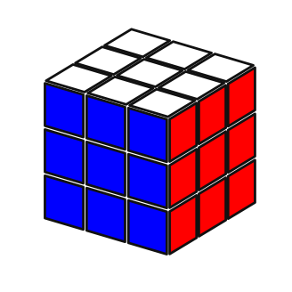
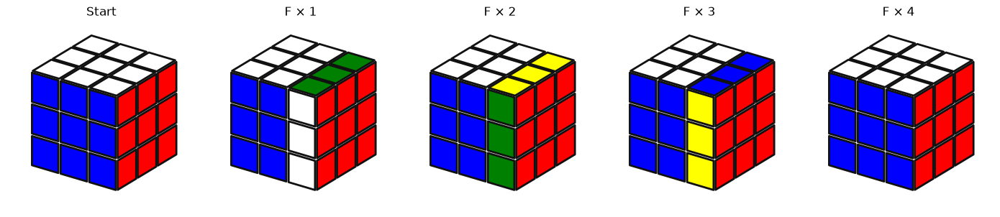

# Rubik's Cube Solver

[Português](README.md) | [English](README.en.md)

A personal project to study and build a 3×3 Rubik's Cube solver in Python, step by step. The goal is to understand the cube representation, generate moves from geometry, and then explore search and heuristics without relying on a ready-made solving library.

## Current status

- The cube is represented by 54 stickers, nine per face.
- Sticker positions are defined with 3D coordinates.
- The `U`, `L`, `F`, `R`, `B`, and `D` moves are generated geometrically, along with their inverses and double turns.
- The notebook compares the geometric `U` move with a manual reference, shows a full turn of `F`, and checks map properties, centers, and piece integrity.
- A solver that finds solutions has not been implemented yet.

The solved cube visualization:



A full turn of `F`:



## Cube representation

The state is a 54-position vector, equivalent to a `1 × 54` row, ordered by faces `[U, L, F, R, B, D]`. Each face takes nine positions, read from left to right and top to bottom:

| Face | Indices |
| --- | --- |
| `U` | `0–8` |
| `L` | `9–17` |
| `F` | `18–26` |
| `R` | `27–35` |
| `B` | `36–44` |
| `D` | `45–53` |

In the solved cube, each block of nine positions contains the color of its face. To understand the moves, it is useful to temporarily use unique identifiers:

```python
ids = np.arange(54)  # [0, 1, 2, ..., 53]
```

This lets us track where each sticker goes. The 3D coordinates define a geometric rotation; that rotation is converted into a **permutation map** of 54 indices. So the final operation is not a 3D rotation matrix applied directly to the colors: it is a permutation of the sticker vector.

### Example: the U move

`gerar_mapa_movimento("U")` builds the 90° rotation of the upper layer. The map stores the source index for each destination position. That is why applying the map means indexing the state with it:

```python
mapa_U = gerar_mapa_movimento("U")
state = np.arange(54)
state_after_U = state[mapa_U]
```

With the current convention, the `U` map is:

```text
[6, 3, 0, 7, 4, 1, 8, 5, 2,
 18, 19, 20, 12, 13, 14, 15, 16, 17,
 27, 28, 29, 21, 22, 23, 24, 25, 26,
 36, 37, 38, 30, 31, 32, 33, 34, 35,
 9, 10, 11, 39, 40, 41, 42, 43, 44,
 45, 46, 47, 48, 49, 50, 51, 52, 53]
```

For example, destination `0` receives the sticker that was at index `6`; destination `9` receives the sticker that was at index `18`. When applied to the identifier vector `[0, 1, 2, ..., 53]`, the result is exactly the list above. To apply the move to the cube colors, we use the same operation:

```python
cube_after_U = girar_cubo(cubo_resolvido, mapa_U)
```

In the code's notation, `U` is clockwise when viewed from outside that face; `U'` is its inverse and `U2` is a double turn. The same applies to the other five faces.

## Getting started

Install the dependencies:

```bash
python -m pip install -r requirements.txt
```

Open `rubikscube.ipynb` in Jupyter or Google Colab and run the cells in order. The notebook uses NumPy for vectors and coordinates, and Matplotlib for 3D plots.

## Main files

- [`cubo.py`](cubo.py): face coordinates, move-map generation, and functions to print, turn, and visualize the cube.
- [`rubikscube.ipynb`](rubikscube.ipynb): cube state construction and visual/algebraic checks.
- [`images/`](images/): images used in this README.
- [`requirements.txt`](requirements.txt): Python dependencies.

## Next steps

The move foundation is ready for search. The next step is to define a node's state, how to detect repeated states, and how to represent the goal (a solved cube). Then we can choose a search strategy and build a heuristic that estimates how many moves remain. An explicit representation of corners and edges may help when we create more informative heuristics.
