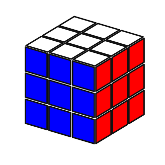
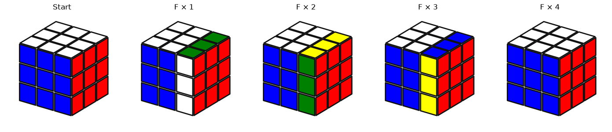

# Solver de cubo mágico 3×3

[Português](README.md) | [English](README.en.md)

Projeto pessoal para estudar e construir, passo a passo, um solver de cubo mágico 3×3 em Python. A ideia é entender a representação do cubo, gerar os movimentos pela geometria e, depois, explorar busca e heurísticas sem depender de uma biblioteca pronta de resolução.

## Estado atual

- O cubo é representado por 54 adesivos, nove por face.
- As posições dos adesivos são definidas em coordenadas 3D.
- Os movimentos `U`, `L`, `F`, `R`, `B` e `D` são gerados geometricamente, junto com seus inversos e giros duplos.
- O notebook compara o movimento `U` geométrico com uma referência manual, mostra uma volta completa de `F` e verifica propriedades dos mapas, dos centros e das peças.
- Um solver que encontre soluções ainda não foi implementado.

A visualização inicial do cubo resolvido:



Uma volta completa de `F`:



## Representação do cubo

O estado é um vetor de 54 posições, equivalente a uma linha `1 × 54`, organizado na ordem de faces `[U, L, F, R, B, D]`. Cada face ocupa nove posições, lidas da esquerda para a direita e de cima para baixo:

| Face | Índices |
| --- | --- |
| `U` | `0–8` |
| `L` | `9–17` |
| `F` | `18–26` |
| `R` | `27–35` |
| `B` | `36–44` |
| `D` | `45–53` |

No cubo resolvido, cada bloco de nove posições tem a cor da sua face. Para entender os movimentos, é útil usar temporariamente identificadores únicos:

```python
ids = np.arange(54)  # [0, 1, 2, ..., 53]
```

Assim conseguimos acompanhar para onde cada adesivo foi. As coordenadas 3D definem uma rotação geométrica; essa rotação é convertida em um **mapa de permutação** de 54 índices. Portanto, o resultado final não é uma matriz 3D de rotação aplicada diretamente às cores: é uma permutação do vetor de adesivos.

### Exemplo: movimento U

A função `gerar_mapa_movimento("U")` constrói a rotação de 90° da camada superior. O mapa guarda, para cada posição de destino, o índice de origem. Por isso, aplicar o mapa é indexar o estado por ele:

```python
mapa_U = gerar_mapa_movimento("U")
estado = np.arange(54)
estado_depois_de_U = estado[mapa_U]
```

Com a convenção atual, o mapa `U` é:

```text
[6, 3, 0, 7, 4, 1, 8, 5, 2,
 18, 19, 20, 12, 13, 14, 15, 16, 17,
 27, 28, 29, 21, 22, 23, 24, 25, 26,
 36, 37, 38, 30, 31, 32, 33, 34, 35,
 9, 10, 11, 39, 40, 41, 42, 43, 44,
 45, 46, 47, 48, 49, 50, 51, 52, 53]
```

Por exemplo, o destino `0` recebe o adesivo que estava no índice `6`; o destino `9` recebe o que estava no índice `18`. Aplicado ao vetor de identificadores `[0, 1, 2, ..., 53]`, o resultado é exatamente a lista acima. Para aplicar o movimento às cores do cubo, usamos a mesma operação:

```python
cubo_depois_de_U = girar_cubo(cubo_resolvido, mapa_U)
```

Na notação usada no código, `U` é horário visto de fora da face; `U'` é o inverso e `U2` é o giro duplo. O mesmo vale para as outras cinco faces.

## Como executar

Instale as dependências:

```bash
python -m pip install -r requirements.txt
```

Abra `rubikscube.ipynb` no Jupyter ou Google Colab e execute as células em ordem. O notebook usa NumPy para os vetores e coordenadas, e Matplotlib para os gráficos 3D.

## Arquivos principais

- [`cubo.py`](cubo.py): coordenadas das faces, geração dos mapas de movimento e funções para imprimir, girar e visualizar o cubo.
- [`rubikscube.ipynb`](rubikscube.ipynb): construção do estado e testes visuais e algébricos.
- [`images/`](images/): imagens usadas neste README.
- [`requirements.txt`](requirements.txt): dependências Python.

## Próximos passos

A base de movimentos já permite começar a busca. O próximo passo é definir o estado de um nó, como identificar estados repetidos e como representar o objetivo (cubo resolvido). Depois podemos escolher uma estratégia de busca e construir uma heurística que estime quantos movimentos faltam. Uma representação explícita de cantos e arestas pode ajudar quando formos criar heurísticas mais informativas.
